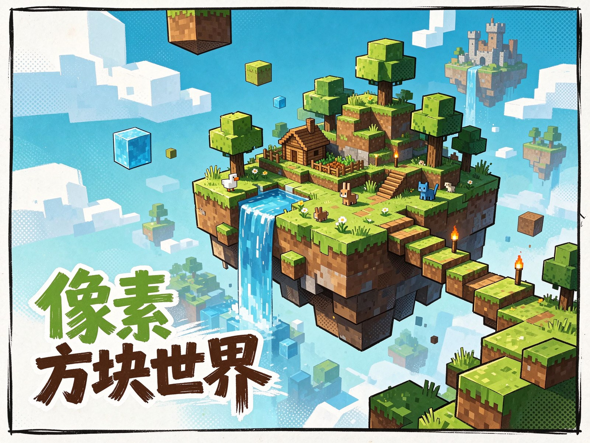

<p align="center"></p>

<h1 align="center">像素方块世界 · mc.aikex.ink</h1>

<p align="center">开源的体素沙盒：单机存档、联机房间、地狱与末地、末影龙、管理面板</p>

<p align="center">
  <a href="https://mc.aikex.ink/">在线试玩</a> ·
  <a href="https://aiyangdie.github.io/mc-aikex-ink/">Pages 预览</a>
</p>

## 简介

用 Three.js 写的浏览器端体素沙盒，服务器权威处理联机。推 `main` 会同时更新 Pages 静态页与生产站；Pages 只能托管静态资源，联机请求自动连回 `mc.aikex.ink`。

## 功能

- **世界与维度**：方块建造与破坏、地形生成、传送门进入地狱与末地
- **联机房间**：房间列表、同维度玩家同步、房主管理面板（按 `` ` `` 打开）
- **战斗**：AK 与法师双职业，火球持续灼烧 5 秒，闪现冷却 3.2 秒，服务端校验射速与命中
- **Boss**：末影龙与「迷雾档案」Boss，单机存档、联机每房共享状态
- **管理**：站长密钥管理目录与权限，房主可锁人、回血、刷怪、重置地形
- **共创**：游戏内「生物实验室」拼接部件、调参并把模板发布到服务器共享目录

## 技术栈

Three.js（ES Module 静态站）｜ Node.js + `ws`（WebSocket + `/api/rooms`）｜ Nginx 反代 + PM2 部署

## 本地运行

```bash
# 1) 静态页：任意静态服务器指向仓库根目录
# 2) 联机服务
cd server
cp ecosystem.config.cjs.example ecosystem.config.cjs   # 改 MC_OWNER_KEY
npm install
node server.js
# 浏览器把 /ws 与 /api 反代到 127.0.0.1:3040
```

开发模式：根目录 `pnpm dev`，浏览器打开 `http://127.0.0.1:3040`（同时提供静态资源、模板 REST API 与 WebSocket）。测试：`npm test`；启动本地服务后 `npm run test:online` 用两个真实 WebSocket 客户端跑击杀、重生与冷却流程。

## 项目结构

```
index.html / js / styles/    浏览器端
server/server.js             联机与管理 API
server/ecosystem.config.cjs  生产进程配置（示例入库，实际文件 gitignore）
docs/WORLD_SIM.md            世界模拟层约定
```

## 协作与安全

分支 `feat/xxx` → PR → 至少一人 Review → 合并 `main` 后 GitHub Actions 自动部署到生产机。`MC_OWNER_KEY`、GitHub PAT、`admins.json` 一律不要提交。

## 已知限制

联机维度传送后方块差分尚未按维度隔离；跨维度生物仍会互相可见。地形遮挡与移动仍由客户端上报，属于体验层校验，不是完整反作弊。

## 许可证

[MIT](LICENSE)
